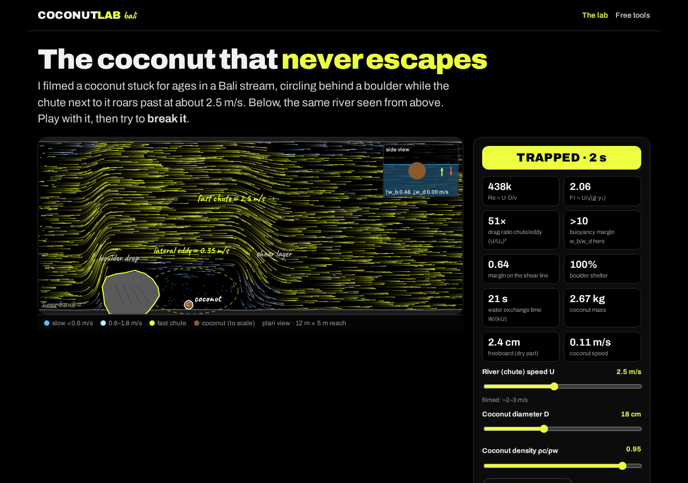

# Coconut Lab Bali · the coconut that never escapes

**Live:** https://andreolf.github.io/coconut-lab/

A free, no-sign-up interactive lab built from a real clip Francesco Andreoli filmed in Bali: a coconut circling for ages in the eddy behind a boulder, while the chute next to it runs at ~2.5 m/s. You see the river in plan view with eddy particles, tune the chute speed, coconut diameter, coconut density and eddy strength, and watch a live **TRAPPED / ESCAPING** indicator together with the Reynolds number, Froude number and chute/eddy drag ratio. Then hit **flood surge** and break it.

By Francesco Andreoli, mechanical engineer (ETH Zurich alumnus) · YouTube [@swissintech](https://www.youtube.com/@swissintech) · X [@francescoswiss](https://x.com/francescoswiss)

> **Honest disclaimer.** This is a simplified, educational model, with parameters estimated from a 14-second video, not measured. The flow is prescribed, not solved. It's great for building intuition about separation, shear layers, drag and buoyancy, but it is not validated CFD, so don't design anything with it. The [free tools page](https://andreolf.github.io/coconut-lab/tools.html) outlines how to do it properly with OpenFOAM / DualSPHysics.



## Run locally
Requires Node 18+. The site itself has zero runtime dependencies; Playwright is only used for tests.
```bash
npm run build          # src/ -> dist/ (inlines partials, copies assets)
npm run preview        # serves dist/ on http://localhost:4173
npm run dev            # build + preview
```

## Test
```bash
npm i && npx playwright install chromium
npm run test:e2e       # Playwright: desktop 1280 + mobile 390, no console errors, assets load; writes screenshots/
npm run test:pages     # same suite, served under /coconut-lab/ exactly like GitHub Pages
npm run test:live      # same suite against https://andreolf.github.io/coconut-lab/ (screenshots/live-*.png)
```

## Deploy
GitHub Pages serves the `gh-pages` branch, which holds the contents of `dist/` plus a `.nojekyll`. All asset paths are relative, so the site works under the project subpath.
```bash
npm run build
git fetch origin gh-pages && git worktree add ../coconut-lab-gh-pages gh-pages
rsync -a --delete --exclude .git dist/ ../coconut-lab-gh-pages/ && touch ../coconut-lab-gh-pages/.nojekyll
cd ../coconut-lab-gh-pages && git add -A && git commit -m "deploy" && git push origin gh-pages
cd - && git worktree remove ../coconut-lab-gh-pages
```

## Stack
Plain HTML / CSS / vanilla JS (ES modules) + Canvas 2D. No framework, no runtime dependencies, no tracking, no external requests (fonts are self-hosted subsets of Archivo and Caveat, both SIL OFL). Zero-dependency Node build (`build.mjs`) and preview server (`serve.mjs`); Playwright for end-to-end tests.

## License
[MIT](LICENSE) © 2026 Francesco Andreoli. Fonts: Archivo and Caveat under the SIL Open Font License.

## Layout
- `src/index.html`: the lab (landing page); `src/tools.html`: free open-source tools + a path to a real CFD run
- `src/partials/`: `head`, `nav`, `footer` inlined by the build
- `src/js/coconut-core.js`: plan-view eddy field + coconut dynamics (pure, also runs in Node)
- `src/js/coconut.js`: rendering and UI; `src/js/sketch.js`: hand-drawn canvas helpers
- `test/e2e.mjs`: Playwright checks; `test/static-server.mjs`: test server (optionally under a subpath)

## The model (educational approximation)
Analytic stream-function flow field: a tanh shear layer, flow-rate-conserving chute acceleration past the boulder, and a closed cellular eddy in its lee. The boulder's shelter fades between U = 3.2 and 4.4 m/s (a stand-in for overtopping). The coconut follows a reduced Maxey–Riley equation (quadratic drag on the submerged frontal area, added mass C_A = 0.5, fluid-acceleration force), with Ornstein–Uhlenbeck turbulence in the shear layer and a vertical balance of downwelling w_d = 0.3·U against the buoyant rise w_b = √(8/3 · g R (1−s) / C_D). Pulled under means carried off by the underflow.

Also by the same author: [Subak Lab, Bali rice terraces](https://andreolf.github.io/subak-lab/).
