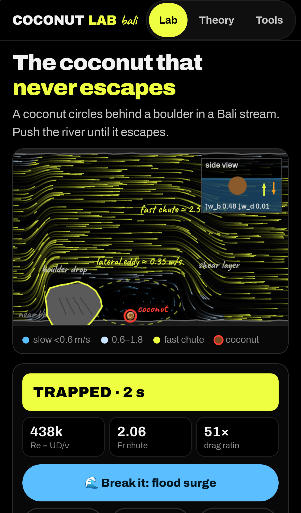

# Coconut Lab Bali · the coconut that never escapes

**Live:** https://andreolf.github.io/coconut-lab/ · [Theory](https://andreolf.github.io/coconut-lab/theory.html) · [Free tools](https://andreolf.github.io/coconut-lab/tools.html)

A free, no-sign-up interactive explainer built from a real 13.8-second clip Francesco Andreoli filmed in Bali: a coconut circling for ages in the eddy behind a boulder while the chute beside it runs at ~2.5 m/s.

- **Lab** (`index.html`): a live plan-view simulation of the river (eddy particles, coconut ringed in red) with sliders for chute speed, coconut diameter, density and eddy strength, a TRAPPED / ESCAPING indicator with Re, Fr and the chute/eddy drag ratio, a **flood surge** button and four "break it" challenges. Below it is the real footage: annotated stills and a 3-second loop.
- **Theory** (`theory.html`): a 14-section explainer covering the lateral eddy, shear layer and downwelling, residence time T = W/(kU), buoyancy vs downwelling, the free-body diagram and the Maxey–Riley equation, drag and Reynolds number, tumbling and L = Iω, Froude numbers and the drowned hydraulic jump, control volumes, why floods free it, and an honest section on what the model gets wrong. The math is rendered with KaTeX and the figures are inline SVG.
- **Tools** (`tools.html`): the open-source stack (FreeCAD, Onshape, Gmsh, Salome, OpenFOAM, DualSPHysics, ParaView, Python) and a recipe for a real CFD run.

It is mobile-first: designed at 390 px, with touch targets of 44 px or more, safe-area insets, a sim that pauses off-screen and respects reduced motion, and equations that scroll inside their own boxes.

By Francesco Andreoli, mechanical engineer (ETH Zurich alumnus) · YouTube [@swissintech](https://www.youtube.com/@swissintech) · X [@francescoswiss](https://x.com/francescoswiss)

> **Honest disclaimer.** This is a simplified, educational model. Its parameters are estimated from a short video, not measured. The flow is prescribed, not solved, and the assumed coconut mass (2.67 kg at s = 0.95) looks inconsistent with the footage and needs recalibrating (see Theory §13). Use it for intuition only, not for design.



## Run locally
Requires Node 18+. The site itself has zero runtime dependencies; Playwright is only used for tests.
```bash
npm run build          # src/ -> dist/ (inlines partials + SVG figures, pre-renders KaTeX math, copies assets)
npm run preview        # serves dist/ on http://localhost:4173
npm run dev            # build + preview
```

## Test
```bash
npm i && npx playwright install chromium webkit   # WebKit on Linux may also need: sudo npx playwright install-deps webkit
npm run test:e2e       # Playwright on desktop 1280, iPhone 13/14 (WebKit), Pixel 7, 360px Android and landscape; writes screenshots/
npm run test:pages     # same suite, served under /coconut-lab/ exactly like GitHub Pages
npm run test:live      # same suite against https://andreolf.github.io/coconut-lab/ (screenshots/live-*.png)
```

## Deploy
GitHub Pages serves the `gh-pages` branch, which holds the contents of `dist/` plus a `.nojekyll`. All asset paths are relative, so the site works under the project subpath.
```bash
npm run build
git fetch origin gh-pages && git worktree add -B gh-pages ../coconut-lab-gh-pages origin/gh-pages
cd ../coconut-lab-gh-pages && git rm -rq . && cp -r ../coconut-lab/dist/. . && touch .nojekyll
git add -A && git commit -m "deploy" && git push origin gh-pages      # normal push, no force
cd ../coconut-lab && git worktree remove ../coconut-lab-gh-pages && git branch -D gh-pages
```

## Stack
Plain HTML / CSS / vanilla JS (ES modules) + Canvas 2D. No framework and no runtime JS dependencies (KaTeX runs at build time; only its CSS and woff2 fonts ship), no tracking, no external requests (fonts are self-hosted subsets of Archivo and Caveat, both SIL OFL). A small Node build (`build.mjs`), a preview server (`serve.mjs`), Python for the figures (`scripts/figures.py`), and Playwright for end-to-end tests.

## License
[MIT](LICENSE) © 2026 Francesco Andreoli. Fonts: Archivo and Caveat under the SIL Open Font License. KaTeX is MIT. Video and photos © Francesco Andreoli.

## Layout
- `src/index.html` (lab), `src/theory.html`, `src/tools.html`. Partials (`head`, `nav`, `footer`) live in `src/partials/`.
- `src/figs/*.svg`: theory figures, generated by `scripts/figures.py` and inlined at build time
- `src/assets/`: annotated stills and a 3 s loop (mp4 + webm) cut from the original clip, the og image, and self-hosted fonts
- `src/js/coconut-core.js`: plan-view eddy field and coconut dynamics (pure, also runs in Node)
- `src/js/coconut.js`: rendering and UI; `src/js/sketch.js`: hand-drawn canvas helpers
- `test/e2e.mjs`: Playwright checks; `test/static-server.mjs`: test server (optionally under a subpath)

## The model (educational approximation)
Analytic stream-function flow field: a tanh shear layer, flow-rate-conserving chute acceleration past the boulder, and a closed cellular eddy in its lee. The boulder's shelter fades between U = 3.2 and 4.4 m/s (a stand-in for overtopping). The coconut follows a reduced Maxey–Riley equation (quadratic drag on the submerged frontal area, added mass C_A = 0.5, fluid-acceleration force), with Ornstein–Uhlenbeck turbulence in the shear layer and a vertical balance of downwelling w_d = 0.3·U against the buoyant rise w_b = √(8/3 · g R (1−s) / C_D). Pulled under means carried off by the underflow.

Also by the same author: [Subak Lab, Bali rice terraces](https://andreolf.github.io/subak-lab/).
